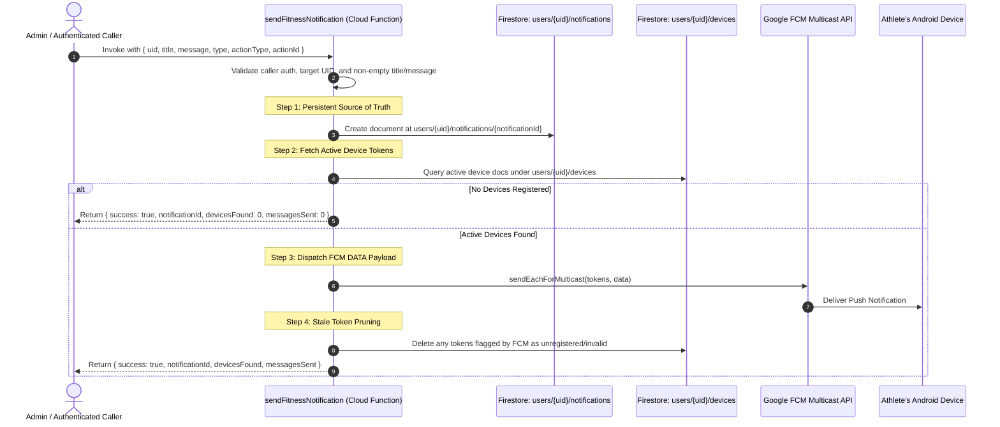

# FITNESS Cloud Functions — Notification Backend (Stage 1)

This package contains the trusted backend logic for dispatching push notifications to FITNESS athletes.

---

## 1. Prerequisites & Setup

### Install Dependencies
Navigate into the `functions` directory and install the required npm packages:
```bash
cd functions
npm install
```

### Build TypeScript
Compile the TypeScript code to JavaScript:
```bash
npm run build
```

### Run Automated Tests
Execute the local unit test suite (validates payload structure, Firestore mapping, and token pruning logic):
```bash
npm test
```

---

## 2. Firebase CLI Authentication & Deployment

### Step 1: Login to Firebase CLI
Ensure you are logged into the Firebase project account:
```bash
npx firebase login
```

### Step 2: Set Active Project
Associate your local directory with your Firebase project:
```bash
npx firebase use <your-firebase-project-id>
```

### Step 3: Deploy Cloud Functions & Firestore Rules
Deploy the function to Firebase:
```bash
# Deploy only the functions
npx firebase deploy --only functions

# Or deploy both Firestore security rules and Cloud Functions together
npx firebase deploy --only firestore:rules,functions
```

---

## 3. Architecture & Execution Flow



---

## 4. How to Test the Function

### Option A: Firebase Console Cloud Functions Dashboard
1. Open the [Firebase Console](https://console.firebase.google.com/).
2. Select your project and navigate to **Build > Functions**.
3. Locate `sendFitnessNotification`.
4. Click the **Testing** tab (or three dots > **Test**).
5. In the request body, provide JSON:
```json
{
  "data": {
    "uid": "<TARGET_USER_FIREBASE_UID>",
    "title": "Today's Workout",
    "message": "Chest + Triceps is waiting for you. 💪",
    "type": "WORKOUT_REMINDER",
    "actionType": "WORKOUT",
    "actionId": "day_14"
  }
}
```
6. Run the test and inspect the returned response:
```json
{
  "result": {
    "success": true,
    "notificationId": "0VpL9x...",
    "devicesFound": 1,
    "messagesSent": 1
  }
}
```

### Option B: Node.js Admin Test Script
You can invoke the function directly via the Firebase Admin SDK from a trusted admin environment without client token overhead. Create a script in `functions/` (never commit private keys):
```javascript
const admin = require("firebase-admin");
admin.initializeApp();

async function triggerNotification() {
  const targetUid = "<ATHLETE_UID>";
  const db = admin.firestore();
  
  // Directly writes to users/{uid}/notifications
  const notifRef = db.collection("users").doc(targetUid).collection("notifications").doc();
  const notifId = notifRef.id;
  
  await notifRef.set({
    id: notifId,
    userId: targetUid,
    title: "Today's Workout",
    message: "Chest + Triceps is waiting for you. 💪",
    type: "WORKOUT_REMINDER",
    read: false,
    createdAt: Date.now(),
    actionType: "WORKOUT",
    actionId: "day_14"
  });

  const devices = await db.collection("users").doc(targetUid).collection("devices").get();
  const tokens = devices.docs.map(d => d.data().token).filter(Boolean);
  
  if (tokens.length > 0) {
    const res = await admin.messaging().sendEachForMulticast({
      tokens: tokens,
      data: {
        notificationId: notifId,
        notification_id: notifId,
        title: "Today's Workout",
        message: "Chest + Triceps is waiting for you. 💪",
        type: "WORKOUT_REMINDER",
        actionType: "WORKOUT",
        actionId: "day_14",
        navigate_to: "notifications"
      }
    });
    console.log(`Sent: ${res.successCount} of ${tokens.length}`);
  }
}
triggerNotification();
```

---

## 5. Verification Checklist

1. **Verify Firestore Document**:
   - Navigate to **Firebase Console > Firestore Database**.
   - Inspect `users/{uid}/notifications/{notificationId}`.
   - Verify fields:
     - `id`: Exact match with `notificationId`
     - `userId`: Exact target UID
     - `title`: String
     - `message`: String
     - `type`: Category string
     - `read`: `false`
     - `createdAt`: Integer timestamp
2. **Verify Android Device**:
   - Look at the Android notification tray on the test device.
   - You should see the Heads-Up notification with the neon-green accent and text `"Today's Workout"`.
   - Tap the notification: FITNESS opens and deep-links to `NotificationScreen`.
   - Because `NotificationScreen` uses real-time snapshot listeners (`getNotificationsFlow`), the Firestore record displays immediately with its unread indicator!
3. **Verify Stale Token Cleanup**:
   - If a device was uninstalled, FCM returns `registration-token-not-registered`.
   - The function automatically deletes the associated dead device record under `users/{uid}/devices/{deviceId}`.

---

## 6. Security Note

- **No Secrets in Client Code**: Never place Google service-account JSON keys, Firebase Admin credentials, or server keys inside Android, iOS, or Kotlin Multiplatform code.
- **Application Default Credentials**: When deployed to Google Cloud / Firebase Cloud Functions, the Admin SDK automatically uses the managed environment service account.
